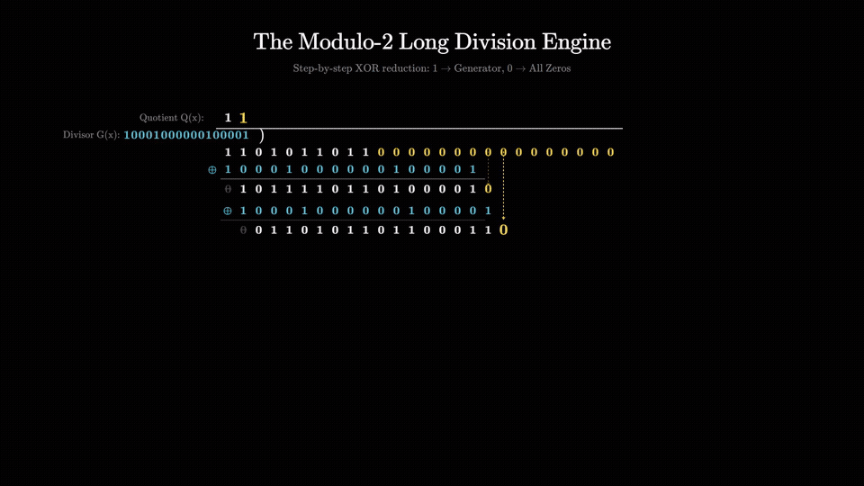
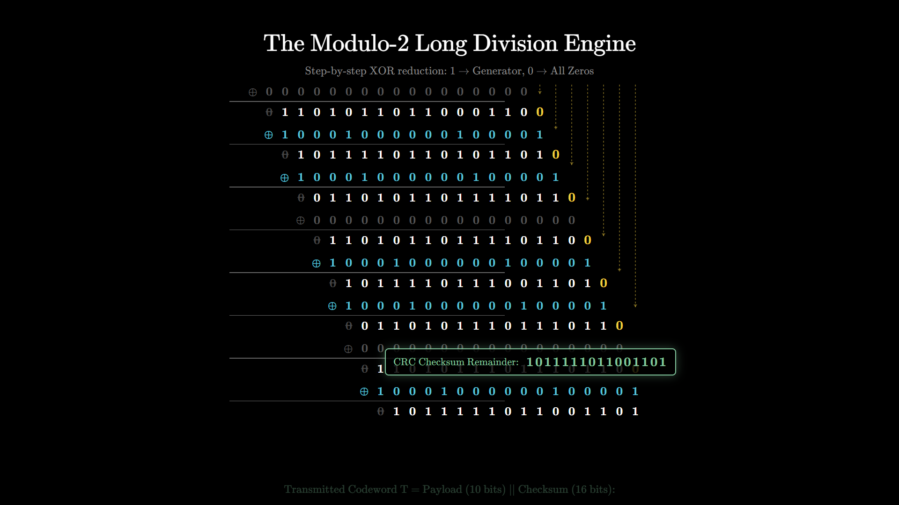
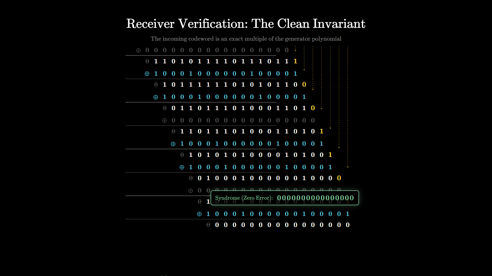
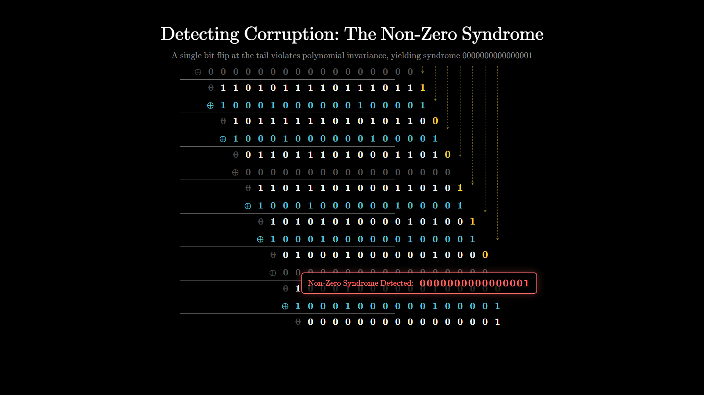

<div align="center">

# Learning CRC Visually (Cyclic Redundancy Check)
### An Authentic 3Blue1Brown-Style Programmatic Explainer in Remotion & KaTeX

[](https://github.com/ommd3076/learning-crc-visually/releases/tag/v1.0.0)
[](https://github.com/ommd3076/learning-crc-visually/raw/main/docs/assets/crc_3b1b_explainer.mp4)
[]()
[]()
[]()
[]()

<br />

<p align="center">
  <b>A pure-void mathematical exploration of Cyclic Redundancy Check (CRC-16-CCITT) from first principles.</b><br />
  Featuring Computer Modern LaTeX typography, spring camera tracking, and zero dead-air audio narration.
</p>

---

## 🎬 Watch the Full 1080p 30fps Explainer Video

https://github.com/ommd3076/learning-crc-visually/raw/main/docs/assets/crc_3b1b_explainer.mp4

<br />

<a href="https://github.com/ommd3076/learning-crc-visually/raw/main/docs/assets/crc_3b1b_explainer.mp4">
  
</a>

<p align="center">
  <a href="https://github.com/ommd3076/learning-crc-visually/raw/main/docs/assets/crc_3b1b_explainer.mp4">
    
  </a>
</p>

<p align="center">
  <b>Full Video Direct Path in Repo:</b> <code><a href="docs/assets/crc_3b1b_explainer.mp4">docs/assets/crc_3b1b_explainer.mp4</a></code> (36.4 MB)<br />
  <b>Direct Raw Streaming Link:</b> <code><a href="https://github.com/ommd3076/learning-crc-visually/raw/main/docs/assets/crc_3b1b_explainer.mp4">raw/main/docs/assets/crc_3b1b_explainer.mp4</a></code>
</p>

</div>

---

## 📐 Mathematical Ground Truth & Lab Notebook Benchmark

This explainer models and proves the exact binary modulo-2 long division verified in the laboratory notebook:

### 1. Parameters & Specification
- **Dataword ($D$)**: `1101011011` (10 bits)
- **Generator Polynomial ($G(x)$)**: CRC-16 / CRC-CCITT standard:
  $$G(x) = x^{16} + x^{12} + x^5 + 1 \longleftrightarrow \texttt{10001000000100001}_2 \quad (\deg = 16)$$
- **Degree ($r$)**: `16`. Append 16 zeros: `0000000000000000`.
- **Augmented Dividend**:
  $$D(x) \cdot x^{16} = \texttt{11010110110000000000000000} \quad \text{(26 bits total)}$$

---

### 2. Classic Handwritten Division Bracket Layout

$$\begin{array}{r@{\quad}l}
\text{Quotient:} & \texttt{1 1 0 1 0 1 1 0 1 1} \\
\text{Divisor} \quad \texttt{10001000000100001} & \overline{\smash{\big)}\; \texttt{1101011011 0000000000000000}} \quad (\text{Augmented Dividend})
\end{array}$$

#### Deterministic Iteration Logic across 10 Cycles:
For each cycle $k \in [0, 9]$:
1. **Evaluate Leading Bit of Active Window**:
   - **Case `1`**: Quotient receives $\texttt{1}$. Subtrahend is the **Generator Polynomial** $\texttt{10001000000100001}$ (in 3B1B Blue `#58c4dd`). Leading bit cancels to $0$.
   - **Case `0`**: Quotient receives $\texttt{0}$. Subtrahend is **Seventeen Zeros** $\texttt{00000000000000000}$ (in Muted Gray `#555555`). Working bits remain unchanged.
2. **Bring Down Next Bit**:
   - Next available bit drops down with an animated glowing dashed vertical arrow (`#f4d03f`).
3. **Repeat** across all 10 cycles until final 16-bit remainder is forged:
   $$\text{CRC Remainder } R(x) = \texttt{1011111011001101}_2 \quad (\text{Mint Green } \#83c99e)$$
4. **Transmitted Codeword ($T$)**:
   $$T = D \mathbin{\Vert} R = \texttt{11010110111011111011001101} \quad (26\text{ bits})$$

---

### 3. Step-by-Step 10-Cycle Division Table

| Cycle | Active Lead Bit | Quotient Bit | Subtrahend Placed | XOR Operation Result | Dropped Next Bit |
|:---:|:---:|:---:|:---:|:---:|:---:|
| **0** | `1` | `1` | Generator $G$ (`10001000000100001`) | `01011110110100001` | $\downarrow 0 \implies \texttt{...00010}$ |
| **1** | `1` | `1` | Generator $G$ (`10001000000100001`) | `00110101101100011` | $\downarrow 0 \implies \texttt{...00110}$ |
| **2** | `0` | `0` | All Zeros $\mathbf{0}$ (`00000000000000000`) | `01101011011000110` | $\downarrow 0 \implies \texttt{...01100}$ |
| **3** | `1` | `1` | Generator $G$ (`10001000000100001`) | `01011110110101101` | $\downarrow 0 \implies \texttt{...011010}$ |
| **4** | `1` | `1` | Generator $G$ (`10001000000100001`) | `00110101101111011` | $\downarrow 0 \implies \texttt{...110110}$ |
| **5** | `0` | `0` | All Zeros $\mathbf{0}$ (`00000000000000000`) | `01101011011110110` | $\downarrow 0 \implies \texttt{...01100}$ |
| **6** | `1` | `1` | Generator $G$ (`10001000000100001`) | `01011110111001101` | $\downarrow 0 \implies \texttt{...011010}$ |
| **7** | `1` | `1` | Generator $G$ (`10001000000100001`) | `00110101110111011` | $\downarrow 0 \implies \texttt{...110110}$ |
| **8** | `0` | `0` | All Zeros $\mathbf{0}$ (`00000000000000000`) | `01101011101110110` | $\downarrow 0 \implies \texttt{...01100}$ |
| **9** | `1` | `1` | Generator $G$ (`10001000000100001`) | `01011111011001101` | **CRC**: $\texttt{1011111011001101}$ |

---

### 4. Receiver Verification: Clean vs. Corrupted Invariant

- **Scenario A (Clean Intact Transmission)**:
  - Input: `11010110111011111011001101`
  - Division by $G(x)$ yields an exact remainder of `0000000000000000` (16 zeros) $\rightarrow$ **Data Accepted**.
  $$T(x) = D(x) \cdot x^{16} \oplus R(x) = Q(x) \cdot G(x) \implies T(x) \pmod{G(x)} \equiv 0$$

- **Scenario B (Single-Bit Corruption)**:
  - Corrupted Codeword: `11010110111011111011001100` (last bit flipped $1 \rightarrow 0$)
  - Modulo-2 division yields non-zero syndrome: `0000000000000001` $\rightarrow$ **Packet Rejected**.
  $$T'(x) \pmod{G(x)} = (T(x) \oplus E(x)) \pmod{G(x)} = E(x) \pmod{G(x)} = 1 \neq 0$$

---

## 🎨 Authentic 3Blue1Brown Aesthetic

- **Pure Pitch-Black Void Canvas (`#000000`)**: No cards, no containers, no UI borders, no telemetry HUD widgets.
- **Pristine KaTeX LaTeX Typography**: Floating Computer Modern / TeX math serif equations rendered directly via KaTeX CSS.
- **Grant Sanderson Color Palette**:
  - Base Math White: `#ffffff`
  - Generator Polynomial: `#58c4dd` (3B1B Blue)
  - Active Working Bits / Arrows: `#f4d03f` (3B1B Gold)
  - Zero Subtrahend Rows: `#555555` (Muted Gray)
  - Final Checksum Remainder: `#83c99e` (Mint Green)
  - Corruption Flag: `#ff6b6b` (Salmon Red)
- **Camera Kinematics**: Viewport smoothly translates upward (`translateY`) with `spring()` physics as the division ladder cascades, maintaining the viewer's focal lock on the active XOR row.

---

## 🖼️ Scene Gallery

<div align="center">

| Act 1: The Channel Noise Paradox | Act 2: Field Theory & Modulo-2 |
|:---:|:---:|
|  |  |

| Act 3: Structuring the Dividend | Act 4: The Modulo-2 Long Division Engine |
|:---:|:---:|
|  |  |

| Act 5: Receiver Clean Invariant | Act 6: Detecting Corruption (Non-Zero Syndrome) |
|:---:|:---:|
|  |  |

</div>

---

## 🎙️ Zero Dead-Air Audio Synchronization

$$\text{durationInFrames} = \lceil\text{audioDurationSeconds} \times 30\rceil$$

Every Remotion sequence duration is strictly clamped to studio-quality narration synthesized offline with **Kokoro-82M ONNX** (voice `bm_george`), accompanied by a continuous warm harmonic ambient acoustic bed (`ambient_bed.mp3` at `0.08` volume).

| Scene | Title | Timing (s) | Frame Count (30fps) | Focus |
|---|---|---|---|---|
| **Scene 1** | The Channel Noise Paradox | 26.94s | 809 | 2-bit burst error parity blind spot |
| **Scene 2** | Field Theory & Modulo-2 Arithmetic | 34.28s | 1029 | Galois Field $\text{GF}(2)$, $1 \oplus 1 = 0$, no carries |
| **Scene 3** | Structuring the Dividend & Degree-16 Generator | 36.97s | 1110 | $x^{16} + x^{12} + x^5 + 1$ mapping & 16 zero padding |
| **Scene 4** | Sender Long Division Walkthrough | 68.18s | 2046 | 10-cycle ladder with 1-vs-0 subtrahend logic |
| **Scene 5** | Receiver Verification: Clean Invariant | 36.67s | 1101 | $T(x) \pmod{G(x)} \equiv 0$, 16 zeros remainder |
| **Scene 6** | Detecting Corruption: Non-Zero Syndrome | 35.05s | 1052 | Bit 25 flipped, syndrome $\texttt{...0001} \neq 0$ |
| **Total** | **Crc3B1BExplainer** | **238.23s** | **7147 frames** | **Continuous ~4min audio-visual explainer** |

---

## 🚀 Quickstart & Reproduction

### Prerequisites
- Node.js $\ge 18$
- Python $\ge 3.10$ with `kokoro-onnx` and `soundfile`
- FFmpeg (on system PATH)

### Install Dependencies
```bash
git clone https://github.com/ommd3076/learning-crc-visually.git
cd learning-crc-visually
npm install
pip install kokoro-onnx soundfile sounddevice
```

### Synthesize Audio Tracks
```bash
npm run generate-audio
```

### Preview in Remotion Studio
```bash
npm run start
```

### Render Full 1080p 30fps Video
```bash
npm run render
```

---

## 📜 License
MIT License. Built with ❤️ using Remotion and KaTeX.
